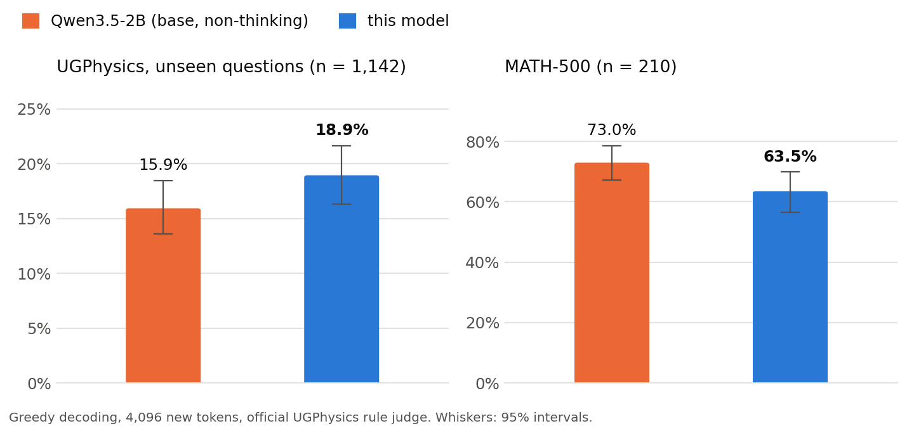
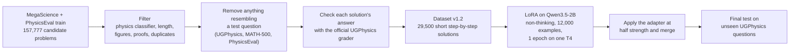

<div align="center">

# Qwen3.5-2B Physics

**A 2-billion-parameter model fine-tuned on free Google Colab T4 GPUs to solve undergraduate physics problems.**<br>
On 1,142 UGPhysics questions it never saw during development, it scores **18.9% vs 15.9%** for its base model.

[](https://huggingface.co/eswaroy/qwen3.5-2b-physics)
[](https://huggingface.co/Qwen/Qwen3.5-2B)
[](docs/REPRODUCE.md)
[](LICENSE)
[](https://huggingface.co/eswaroy/qwen3.5-2b-physics)

[**Model**](https://huggingface.co/eswaroy/qwen3.5-2b-physics) ·
[**Results**](docs/RESULTS.md) ·
[**Methods**](docs/METHODS.md) ·
[**Experiment log**](docs/EXPERIMENTS.md) ·
[**Reproduce**](docs/REPRODUCE.md)

</div>

---

## Highlights

- **+3.0 points on unseen physics questions.** UGPhysics (English), 1,142 held-out questions: 15.9% → **18.9%** (paired 95% interval +0.3 to +5.7). The same gain appeared first on the development questions (+3.3, p = 0.0035).
- **Beats both modes of its base model** at the same 4,096-token budget (Qwen3.5-2B thinking mode never finishes within it), and LiquidAI's LFM2.5-1.2B-Thinking.
- **2.7× shorter answers.** 1,006 tokens on average instead of 2,720; only 7% of answers hit the token limit instead of 49%.
- **Honest trade-off.** 9.4 points lower than the base model on MATH-500 (63.5% vs 73.0%), mostly on the hardest problems.
- **Built for free.** Data building, training (about 4.5 GPU hours on one T4) and every evaluation ran on free Colab notebooks.

## Results

<picture>
  <source media="(prefers-color-scheme: dark)" srcset="docs/assets/results_dark.png">
  
</picture>

| Benchmark | Questions | Qwen3.5-2B (non-thinking) | **This model** | Difference |
|---|---|---|---|---|
| UGPhysics, held-out test | 1,142 | 15.9% [13.6, 18.5] | **18.9%** [16.3, 21.7] | **+3.0** [+0.3, +5.7] |
| UGPhysics, development | 1,008 | 14.5% | **17.9%** | +3.3 (p = 0.0035) |
| MATH-500 (regression check) | 210 | **73.0%** | 63.5% | −9.4 (p = 0.044) |

All runs: official UGPhysics prompt and rule-based judge, greedy decoding, at most 4,096 new tokens, float16 on a Tesla T4; UGPhysics scores are weighted by subject size; brackets are 95% intervals. Other models on the development questions: Qwen3.5-2B in thinking mode **0.0%** (it never closed its thinking within 4,096 tokens), LFM2.5-1.2B-Thinking **11.3%**.

These numbers use only the rule judge, not the official two-stage protocol with a GPT-4o judge, so they are not directly comparable with the UGPhysics paper's leaderboard. Full tables, per-subject results and statistics: [docs/RESULTS.md](docs/RESULTS.md).

## Quick start

```python
import torch
from transformers import AutoModelForCausalLM, AutoTokenizer

repo = "eswaroy/qwen3.5-2b-physics"
tok = AutoTokenizer.from_pretrained(repo)
model = AutoModelForCausalLM.from_pretrained(repo, dtype=torch.float16, device_map="auto")

messages = [
    {"role": "system", "content": "Please reason step by step, and put your final answer within \\boxed{}."},
    {"role": "user", "content": "A 2.0 kg block slides from rest down a frictionless incline of height 1.5 m. "
                                "What is its speed at the bottom? Take g = 9.8 m/s^2."},
]
prompt = tok.apply_chat_template(messages, tokenize=False, add_generation_prompt=True, enable_thinking=False)
inputs = tok(prompt, return_tensors="pt").to(model.device)
out = model.generate(**inputs, max_new_tokens=4096, do_sample=False)
print(tok.decode(out[0, inputs["input_ids"].shape[1]:], skip_special_tokens=True))
```

Use the non-thinking chat format and greedy decoding, as in the evaluation. Qwen3.5 needs a recent `transformers` (`pip install -U transformers`).

## How it was built



1. **Data.** Physics problems with worked solutions from [MegaScience](https://huggingface.co/datasets/MegaScience/MegaScience) (textbook physics, NaturalReasoning physics, Nemotron-Science multiple choice, some maths) and the [PhysicsEval](https://huggingface.co/datasets/IUTVanguard/PhysicsEval) training split. Subjects are balanced toward what the exam asks and where the base model is weak. Every problem that overlaps a benchmark question is removed, and every solution whose final answer disagrees with its reference (official grader) is dropped.
2. **Training.** LoRA (rank 32) on attention, Gated DeltaNet and MLP layers of Qwen3.5-2B in its non-thinking chat format; the loss covers the answer only. fp16 with loss scaling, gradient checkpointing, and a chunked loss for the 248K-token vocabulary, so it fits a 15 GB T4.
3. **Half strength.** At full strength the answers became too short for hard problems: on 70 MATH-500 questions maths fell from 67.1% to 51.7%. Applying the adapter at 0.5× kept the physics gain and reduced the maths loss (69.4% on the same 70 questions, 63.5% vs 73.0% on 210).
4. **Evaluation.** A harness that reproduces the UGPhysics protocol, splits the benchmark into development questions (for every decision) and a held-out test (used once), and reports paired statistics.

Details: [docs/METHODS.md](docs/METHODS.md).

## What we learned

The model is the last of several experiments; the full story with every number is in [docs/EXPERIMENTS.md](docs/EXPERIMENTS.md).

| # | Experiment | UGPhysics (dev) | Lesson |
|---|---|---|---|
| 1 | LFM2.5-1.2B-Thinking + short teacher solutions | 13.3% → 5.5% | Short solutions destroyed a thinking model's long reasoning. |
| 2 | LFM2.5-1.2B-Thinking + its own correct answers | 13.3% → 10.9% | Self-distillation kept the reasoning but added no physics skill. |
| 3 | Qwen3.5-2B (non-thinking) + short solutions, full strength | 14.5% → 16.6% | Fixed the rambling (52% → 2% hit the limit) but lost 15 points of maths. |
| 4 | Same adapter at half strength | 14.5% → **17.9%** | Kept the physics gain and reduced the maths loss. |
| 5 | Final test, held-out questions | 15.9% → **18.9%** | The gain is real on questions never used for any decision. |

## Repository layout

```
├── src/                  # the four tools (each one file, run from the notebooks)
│   ├── physeval.py       #   evaluation harness: UGPhysics, MATH-500, PhysicsEval; grading and reports
│   ├── physdata.py       #   training-data builder: filtering, leak checks, grader checks, subject quotas
│   ├── phystrain.py      #   LoRA/DoRA trainer for a free T4 (resumable, fp16, chunked loss)
│   └── physself.py       #   self-distillation data (experiment 2)
├── notebooks/            # Colab notebooks, one per stage (see notebooks/README.md)
├── results/              # evaluation reports, summary.json files, every generated answer (gzip)
├── training/             # training configs, loss logs and sampled answers
├── data/                 # dataset build reports and the v1.2 training data (gzip, CC BY-NC-SA 4.0)
├── tools/                # make_figures.py: the figures in this README
└── docs/                 # results, methods, experiment log, reproduction guide, model card, figures
```

## Reproduce

Everything runs in Google Colab on a free T4: copy `src/*.py` and `notebooks/*.ipynb` into one Google Drive folder (`MyDrive/physics_eval`) and run the notebooks in order. Step-by-step guide, GPU hours per step and how three free accounts were used in parallel: [docs/REPRODUCE.md](docs/REPRODUCE.md).

## Limitations

- About 4 of every 5 undergraduate physics problems are still answered wrongly. Do not rely on its answers without checking them.
- Weaker than the base model on hard maths (MATH-500 Level 5: 49% → 26%).
- About 7% of answers still run past 4,096 tokens.
- English only, text only (Qwen3.5-2B's image encoder is not included), evaluated only with greedy decoding.
- Compared with two model families only. Other small models (for example Qwen3-1.7B, DeepSeek-R1-Distill-Qwen-1.5B, or MegaScience's own fine-tunes) were not evaluated with this harness, so no claim is made about them.

## License

- **Code** (`src/`, `notebooks/`, `docs/`): [MIT](LICENSE).
- **Model weights** (on Hugging Face): CC BY-NC-SA 4.0. The base model Qwen3.5-2B is Apache-2.0.
- **Training data** (`data/`): derived from MegaScience (CC BY-NC-SA 4.0) and PhysicsEval (CC BY-SA 4.0), so it is shared under **CC BY-NC-SA 4.0**. See [data/README.md](data/README.md).
- **Benchmarks**: UGPhysics, MATH-500 and PhysicsEval belong to their authors. This repository stores model outputs, scores and the normalised reference answers used for grading, never the benchmark questions themselves.

## Citation

```bibtex
@misc{qwen35_2b_physics_2026,
  title  = {Qwen3.5-2B Physics: a physics fine-tune of Qwen3.5-2B trained on free Colab GPUs},
  author = {eswaroy},
  year   = {2026},
  url    = {https://github.com/eswaroy/qwen3.5-2b-physics}
}
```

## Acknowledgements

The [Qwen team](https://huggingface.co/Qwen) for Qwen3.5-2B; the authors of [UGPhysics](https://github.com/YangLabHKUST/UGPhysics) for the benchmark and its grader; the creators of [MegaScience](https://huggingface.co/datasets/MegaScience/MegaScience), [PhysicsEval](https://github.com/areebuzair/PhysicsEval) and [MATH-500](https://huggingface.co/datasets/HuggingFaceH4/MATH-500); and Google Colab for the free GPUs.
