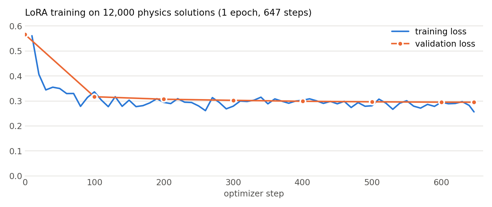

# Training runs

Produced by [`src/phystrain.py`](../src/phystrain.py). The adapter weights are not stored here (they are on [Hugging Face](https://huggingface.co/eswaroy/qwen3.5-2b-physics/tree/main/adapter)); each run folder keeps what is needed to understand and repeat it.

| File | Content |
|---|---|
| `config.json` | every training setting, the data fingerprint and the trainer version |
| `log.csv` | one row every 10 steps: learning rate, training loss, gradient norm, tokens, seconds per step, skipped (overflowing) steps; validation loss and generation-check rows in between |
| `samples.jsonl` | answers written during the generation checks (8 validation questions each time) |

**`qwen-v1.2-lora`** is the run behind the released model (checkpoint 647, applied at half strength). Runs ending in `-speedA`/`-speedB` are 20-step speed tests; the others are the LFM2.5 experiments described in [docs/EXPERIMENTS.md](../docs/EXPERIMENTS.md).

<picture>
  <source media="(prefers-color-scheme: dark)" srcset="../docs/assets/training_dark.png">
  
</picture>
